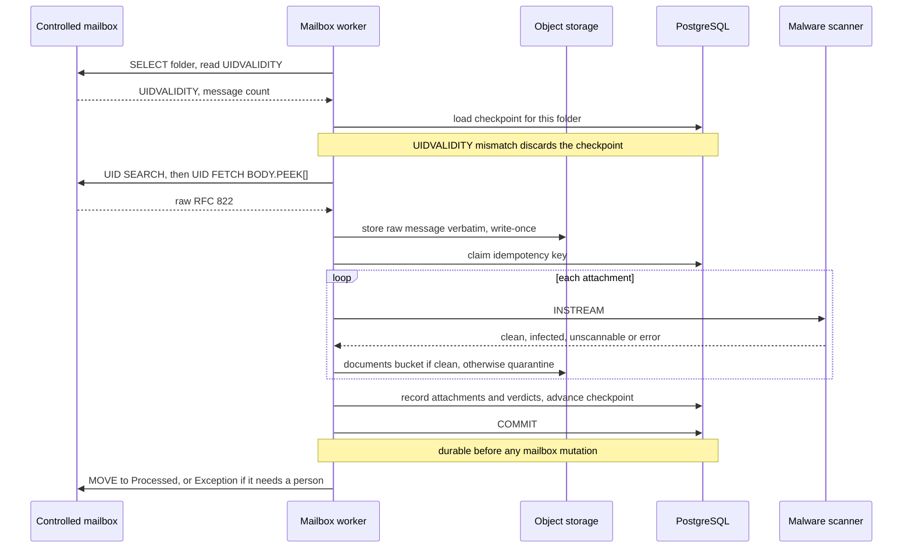

# Email architecture

## Boundary

The platform never touches Outlook, Microsoft 365 mail, Microsoft Graph or
Exchange application permissions. An external forwarding rule, which is out of
scope for this application, delivers a copy of each message into a mailbox the
platform team controls. The platform reads that mailbox over IMAPS and sends
through configurable SMTP.

This boundary is deliberate. It means mailbox access is decoupled from browser
single sign-on: Microsoft Entra ID may be configured as the OIDC provider for
user login without granting the application any mail permission.

## Inbound flow

The ordering is the recovery property, not an implementation detail. Nothing is
moved, flagged or expunged in the mailbox until the record is committed. A crash
after the fetch but before the move leaves the message in the inbox, where the
next poll finds it and the idempotency key recognises it. The reverse ordering
would silently lose mail.

`BODY.PEEK[]` is used rather than `BODY[]` so a fetch does not set `\Seen`: a
crash mid-ingest must leave the message looking untouched.

### Scanning is synchronous, not queued

Attachments are scanned inside the ingest transaction rather than on a queue. The
reason is a state that cannot then exist: there is no window in which a message
is recorded with attachments that have no verdict. A database check constraint,
`stored_requires_verdict`, makes that unrepresentable rather than merely unlikely,
which a queued design cannot do because the row must exist before the job runs.

The cost is that a poll takes as long as its slowest scan. That is acceptable at
invoice volumes, and the batch size bounds it. If throughput ever demands a
queue, the constraint above is what the design must preserve: a row whose
attachments are unjudged must not be visible as ready.

The `Processing` folder from the original design is not used. It existed to mark
messages handed to a scan queue, and with a synchronous scan a message is only
ever in the inbox or in its final folder, so a third state would be a lie the
recovery path has to reason about.

## Forwarding shapes

Both common forwarding styles must work:

- **Transparent forwarding** where headers are rewritten and the body is
  preserved inline.
- **Forwarding as an attachment** where the original arrives as a nested
  `message/rfc822` part.

The outer sender and the detected original sender are stored in separate
columns. Neither is trusted. Header-derived values are treated as claims to be
corroborated, because forwarding can rewrite envelope and `Received` headers,
and because a forged `From` is trivial to produce.

## Idempotency

One key decides whether a message is a repeat, stored in
`inbound_messages.idempotency_key` under a unique constraint. The database
arbitrates, so two workers delivering the same message produce one record rather
than two racing checks that both pass.

| Signal | Used when | Catches |
|---|---|---|
| `Message-ID` | The message has one | The same message arriving through a second route, and two forwards of one original |
| SHA-256 of the raw message | No usable `Message-ID` | Repeat delivery of a message the sender left unidentified |

`Message-ID` is preferred because two forwards of the same original have
different raw bytes but the same `Message-ID`, so hashing alone would file them
as two invoices. It is not sufficient on its own, being sender-controlled and
sometimes absent, which is why the raw hash is the fallback rather than an
alternative.

UID is deliberately *not* part of identity. A UID is only meaningful within a
UIDVALIDITY, so building identity on it would mean a mailbox rebuild produces a
duplicate of everything. UID is used only for the polling checkpoint.

A second constraint, `uq_message_attachments_content` on
`(message_id, sha256)`, means the same file attached twice to one message is one
stored object.

Manual uploads are wrapped as RFC 822 with a `Message-ID` derived from the file
hash and the uploader, so the same person uploading the same file twice is
recognised as a duplicate. A random identifier there would have re-created
exactly the duplicate-payment risk intake exists to prevent. Two *different*
people uploading the same file do get separate records: attribution differs and
each submitter needs their own trail.

## Folder lifecycle

`INBOX`, then `Processed` for a message that needs nothing further, or
`Exception` for one carrying a quarantined or refused attachment, a parse
warning, or any other condition needing a person. Routing on
`IngestOutcome.needs_attention` means the mailbox itself shows the backlog.

`MOVE` is used where the server advertises the extension, because it is atomic.
Otherwise the adapter falls back to `COPY` then setting `\Deleted`, and
deliberately does **not** expunge: a message that has been copied is safe to
leave flagged in place, whereas an expunge racing a failure would destroy the
only remaining copy. A failed move is therefore benign, costing one duplicate
detection on the next poll rather than the message.

## Recovery cases

Each of these is a required test, not a theoretical concern: connection loss
mid-fetch, authentication failure, rate limiting, mailbox quota exhaustion,
UIDVALIDITY reset, worker restart mid-batch, malformed MIME, deeply nested
forwarded messages, and credential rotation.

Covered in `tests/integration/test_imap_worker.py`:

| Case | Expected behaviour |
|---|---|
| UIDVALIDITY changed | Checkpoint discarded and the folder re-read; already-seen messages are absorbed by the idempotency key, not re-recorded |
| Ingest raises for one message | That message stays in the inbox and the checkpoint does not advance past it, so the failure is retried rather than skipped |
| Move fails after commit | The record stands; the next poll re-fetches and detects the duplicate |
| Attachment unscannable | Quarantined, message routed to `Exception`, never treated as clean |

The checkpoint advances only over messages that were fully handled. Advancing
past a failure would convert a transient scanner outage into permanently
unprocessed invoices, which is a silent loss of a payable.

## Outbound flow

Outbound mail uses a transactional outbox. The business transaction commits
first; a worker then sends from the committed outbox row and records the
provider response. This prevents both the lost notification and the phantom
send that a direct inline send would allow on failure.

Recorded per message: `Message-ID`, recipients, template identifier and version,
the business record it concerns, attempt count and provider response.

## Reply correlation

Replies are matched using `In-Reply-To` and `References`, a signed token in the
reply-to address or link, and a subject token as a last resort. Subject alone is
never sufficient, because subjects are edited, translated and reused.

**Email replies cannot approve an internal financial action.** A vendor reply
may suggest that a payment was received, and a signed link may record a vendor's
own confirmation, but the transition to Paid requires an authorized reviewer
acting in the application.

## Loop and abuse protection

Automatic replies are detected and suppressed rather than answered. Vendor
follow-ups are rate-limited per record and per vendor. Reminders honour business
hours and a maximum count so a stalled record cannot generate unbounded mail.

Routine reminders and approval requests carry secure deep links rather than
sensitive attachments, so a forwarded notification does not leak an invoice.

## Production prerequisites

SPF, DKIM and DMARC alignment must be validated before production use. The
application checks readiness and reports it in operational health, but does not
attempt to manage DNS.
