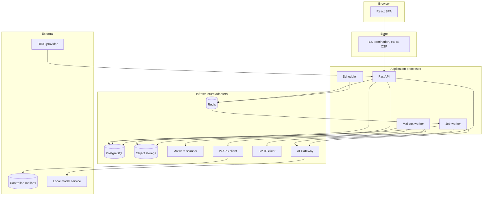

# Solution architecture

## Shape

A secure modular monolith with replaceable infrastructure adapters. One
deployable API process plus separate worker processes, all speaking to shared
PostgreSQL, Redis and object storage. The scale-out path is to extract a module
behind its existing application-layer port without touching business code.

## Layering

The API is divided into three layers with a strict dependency direction. Inner
layers never import outer ones.

| Layer | Contains | May depend on |
|---|---|---|
| `domain` | Money, workflow state machine, roles and permissions, policy rules | Nothing outside the standard library |
| `application` | Use cases, ports (protocols) for storage, mail, scanning and AI | `domain` |
| `infrastructure` | PostgreSQL, S3, Redis, IMAP, SMTP, scanner and AI Gateway adapters | `application`, `domain` |
| `api` | Routers, request and response schemas, authorization dependencies | All of the above |

Business modules depend on ports, not on concrete adapters. This is what makes
the AI provider, object store and mail transport replaceable, and it is why the
same code can be tested against Greenmail in development and a real mailbox in
production.

## Process model

- **API** serves the OpenAPI contract and nothing else. It never performs a
  long-running scan, extraction or send inline.
- **Mailbox worker** owns the IMAP connection and its checkpoints. Only one
  instance may hold a given mailbox lease at a time.
- **Job worker** consumes durable Redis queues for scanning, extraction,
  reminders and outbound mail, with retries and a dead-letter queue.
- **Scheduler** enqueues polling, reminder and escalation work. Polling remains
  enabled even when IMAP IDLE is available, because polling is the recovery
  source of truth.

## Persistence

PostgreSQL holds all business state with database-level constraints rather than
application-only validation. Money is stored as `BIGINT` minor units plus a
`CHAR(3)` currency; there is no `FLOAT` anywhere near an amount. Timestamps are
`TIMESTAMPTZ` in UTC, with the display timezone applied at the presentation
layer.

Financial and audit rows are never hard-deleted. Corrections create a new
version and leave the prior version intact, so history cannot be rewritten.

Concurrency uses an integer `version` column checked on every state change, so
two approvers acting on one record produce a clear conflict rather than a lost
update.

## Object storage

Four buckets with versioning enabled: raw messages, documents, quarantine and
exports. Raw RFC 822 messages are written before any parsing, and their SHA-256
hash is recorded in PostgreSQL so tampering is detectable. Downloads are served
through short-lived signed URLs, never public reads, and every download is
authorized and audited.

Keys are content-addressed by hash, so writing the same bytes twice is the same
object. `put_immutable` reads back an existing key and refuses if the content
differs, which turns an accidental overwrite of evidence into an error instead of
a silent substitution. Server-side encryption is applied on every put by the
adapter, not left to bucket policy, so a misconfigured bucket cannot produce
plaintext objects. `signed_url` refuses the quarantine bucket outright: infected
bytes are retained for investigation, and no request path should be able to mint
a link to them.

## Reading a document

Reading is a pipeline with a deliberate order, because the order is what makes a
value explainable afterwards.

1. **Text.** The stored bytes are opened and every word is recorded with the page
   and box it occupies. A document with no text layer stops here and is marked for
   manual entry rather than guessed at.
2. **Kind.** The document's own title decides whether it is an invoice, an
   estimate, a statement or a receipt.
3. **Rules.** Deterministic label matching fills what it can. Each value carries
   its page, line and box, and a confidence derived from how the value was found
   rather than assigned by anything statistical.
4. **Model.** Only the fields still empty are put to the AI Gateway, and only for
   a kind something downstream processes.
5. **Rules again.** Surviving proposals are merged and the rules run a second time
   over the fuller picture, so a proposed currency can inform how an amount is read.
6. **Cross-checks.** Line items are added against the total, dates are compared,
   currencies are counted, and anything that does not reconcile becomes a signal.

Nothing here writes a financial record. The output is a versioned extraction
attached to the document, and a person accepts it. Correcting a field supersedes
the earlier value instead of replacing it, so a document shows both what was read
and what a named person decided, with the evidence for each.

Three conditions force a human decision regardless of confidence: bank details
printed on the document, text on the page addressed to an automated reader, and a
kind nobody could determine. Each has to be acknowledged by name before the
reading can be accepted.

### The AI Gateway

One module is the only route from this platform to a language model, and it is
readable end to end for that reason. Business code asks it for suggestions and
gets back values that have already been checked, or a plain statement that it has
none.

What it enforces: a proposal is discarded unless its text can be located in the
document; requests carry the document's text and nothing else, no vendor master,
no user identity, no other document; document text travels inside a fence whose
delimiter is generated per request and is labelled to the model as untrusted; a
surviving proposal is stored with origin `model` and a confidence deliberately
below the review threshold, so it is always confirmed by a person from the page
itself; and every answer records the model, prompt identifier, prompt version and
the hash of the exact prompt used, so a value accepted months ago can still be
explained after both have been replaced.

The reasoning, and what is knowingly given up, is in
[ADR 6](../adr/0006-grounded-model-proposals.md).

## Approving a spend

An estimate is the first record in this platform that a person is asked to
authorise, so it is where the approval machinery lives. Two modules divide the
work. `application/estimates.py` owns what an estimate is and which states it may
move between; `application/approvals.py` owns who has to say yes.

The split matters because the two change for different reasons. A new field on an
estimate is not a change to who approves it, and a new approval band is not a
change to what an estimate is.

### Working out the route

A route is derived, never typed. Stored rules map an amount band in a given
currency, optionally narrowed to a department, onto an ordered list of levels.
Steps sharing an order are parallel and any one of them satisfies it; different
orders are sequential and the later one is closed until the earlier is met.

Three properties are deliberate:

- **An uncovered amount is refused, not routed.** If no rule matches, or a rule
  names a level with nobody assigned to it, submission fails and says why.
  Routing to an empty set would leave a request sitting approved-by-nobody, and
  silence must never read as approval.
- **The route is shown before it is taken.** A draft displays the route its
  current amount would follow, so a requester knows who they are about to send
  the request to, and can see the route change when the amount does.
- **The route is recalculated on each submission, then frozen.** Rules that
  change after a request is in flight do not retroactively alter a live round.

### Rounds

Each submission opens a numbered round. Withdrawing or rejecting closes the round
rather than clearing it, and resubmitting opens a new one beneath the old.

This is the whole reason approvals are modelled as rounds instead of as a status
on the estimate. "The Unit Head approved this, and then the requester changed the
amount, and then it went round again" is a sentence an auditor asks for, and a
single mutable status cannot tell it. An approval carries the name of whoever gave
it and the time they gave it, permanently, whatever later happens to the request.

### Who may act

Two independent checks, both in the domain rather than in the browser:
permission to decide at a level at all, and segregation of duties on this
particular record. Whoever submitted an estimate cannot approve it, regardless of
the roles they hold, and a step that is not yet due cannot be decided early even
by someone entitled to decide it eventually.

The API tells each screen what that person may do with that record, as an
`actions` block, and the screen renders only those controls. The rules are not
reimplemented in the browser, so a control that appears is one the server will
honour, and a missing control is a real absence of authority rather than a
styling choice.

### Changing the rules

The matrix is data an administrator edits, and `application/administration.py`
owns the editing. Three properties shape it.

**A rule is superseded, never mutated.** Editing one retires it, stamped with who
retired it and why, and writes a successor. The reason an approval was routed the
way it was in March has to survive somebody rewriting the band in June, and an
UPDATE destroys exactly that. Retired rules stay readable behind a toggle rather
than disappearing.

**A change is judged against the whole matrix, not against itself.** A rule is
individually valid and collectively disastrous far more often than the reverse:
two rules overlapping a band, a gap no amount can cross, a level nobody holds.
`domain/matrix.py` simulates the planner over the proposed set and reports faults
and gaps, and the screen leads with that verdict before it lists anything. A
matrix that routes nothing is the failure that looks most like working.

**The answer offered is the one an administrator wants.** They rarely ask "is
rule four valid"; they ask "what happens to a two million dollar invoice from
Facilities". `/admin/matrix/preview` runs the real planner over a hypothetical
amount and returns the route or the reason there isn't one.

Who holds a level is separate from what a level does, at `/admin/assignments`.
Keeping them apart means a person leaving is not a change to the matrix.

### Absence

An approval queue's commonest way of stalling is nobody noticing that the person
it routes to is away. Cover is therefore a first-class arrangement rather than a
note in a calendar: `delegate_to_id` with an `out_of_office_until`, applied by the
planner at routing time.

Four things it will not do, all in `domain/delegation.py`: cover yourself, cover
through a chain (A to B to C collapses accountability into somebody neither party
chose), cover with somebody who cannot decide anyway, or cover with an end date
already past. The screen at `/settings/cover` lists every approver rather than
only those who arranged something, because the person who left without arranging
anything is the one an administrator has come to fix.

### One queue

`/approvals/queue` collects everything awaiting the signed-in approver across
estimates, invoices and purchase orders, oldest first, with how long each has
waited. Three registers each showing their own slice answers "what invoices are
waiting" but not "is anybody waiting on me", which is the question that actually
governs whether the organisation's approvals move.

Aggregation happens in the API rather than the browser: merging three paginated
lists client-side cannot order the result correctly, since the oldest item overall
may be on page two of a list the browser has not fetched.

## Committed spend

A purchase order is a commitment made before the bill arrives, so it is a record
with a life rather than a reference typed onto an invoice. `domain/purchase_orders.py`
keeps two facts apart that are tempting to merge into one status:

- **Approved or not** is the workflow state, and runs through the same matrix and
  the same state machine as everything else.
- **Open or closed** is whether the order is still taking invoices.

A closed order is still an approved commitment, and reads as one. Collapsing the
pair into a single "closed" status loses the distinction between an order that was
honoured and an order that was never authorised, which are opposite facts.

Remaining capacity is derived from the invoices linked to the order rather than
stored as a running total, because a stored total is a second copy of a truth that
already exists and drifts the first time anything is amended. An invoice that would
take an order past its figure is refused with the shortfall named, and raising the
order's figure is an amendment with a reason, which sends it back for approval.

The threshold above which an order is required moved out of `config.py` into
`purchase_order_thresholds`, keyed by currency. A threshold is a policy the
organisation changes, and a policy that needs a deployment to change is one that
stays wrong for a quarter.

## Paying against a bill

An estimate asks permission to spend. An invoice is a supplier saying the money is
now owed, which is a different claim and is checked differently: an approver is
asked whether it should be paid, but before that somebody outside finance is asked
whether the thing arrived at all.

`application/invoices.py` owns the lifecycle and reuses `application/approvals.py`
unchanged for the approval half, because a round is not specific to what is being
approved. What Phase 5 adds is everything that happens before an approver sees it.

### What stops an invoice

Validation is a domain function returning a list of problems, each naming the
field it belongs to and explaining itself in a sentence a person can act on.
The page shows the same list above the form and against the individual boxes, and
the server refuses the transition on the same list, so the two cannot disagree.

Two of the problems are controls rather than gaps in a form:

- **A duplicate invoice number from the same vendor.** Paying a supplier twice for
  one delivery is the most expensive ordinary mistake in accounts payable, and it
  almost always looks like a second copy of an invoice already in flight. A
  partial unique index enforces it in the database, so a race between two clerks
  is decided by PostgreSQL rather than by whichever read the register last.
  Drafts are excluded from that index deliberately: the second copy must be
  saveable, because the person who spotted it needs both records in front of them
  to work out which is which. It is the move out of draft that is refused.
- **An amount exceeding what was approved**, when the invoice is linked to an
  estimate or a purchase order. The tolerance is configuration and defaults to
  zero, so an overrun is reported rather than absorbed.

Linkage is optional and its absence is recorded rather than blocked. An invoice
with no estimate behind it is spend nobody approved in advance, which is allowed
and is exactly the thing an approver should be told.

### Receipt confirmation

An invoice in `pending_sign_off` is waiting on one named person to say the goods
or services arrived. Nothing reaches an approver until they answer, which is why
an invoice with nobody named cannot be sent anywhere — `requester_missing` is a
validation problem like any other rather than a disabled button with no
explanation.

Finance cannot answer their own question. The person who recorded the invoice is
not offered the confirmation controls, and the server refuses the transition
regardless of what the browser sends.

A refusal is a first-class outcome, not an error. Declining stops the chasing,
carries the reason, and moves the invoice to `exception` for finance to resolve
with the supplier. The page then says the receipt was declined and by whom,
because a panel still reading "waiting on the requester" after the requester has
answered sends finance to chase somebody who already replied.

### Chasing, in working hours

`domain/reminders.py` is pure arithmetic over a clock, a calendar and a policy,
and decides only when the next chase falls due and whether now is a reasonable
moment for it. Nothing in it knows what an invoice is.

The interval is three *working* hours. Wall-clock hours would send the second
reminder at two in the morning and the ninth would meet a filter, so the clock
stops at the end of the day, over the weekend, and on the public holidays held in
`business_calendar_days`. Escalation adds the next person up rather than
replacing the recipient, every third reminder, to a maximum depth: quietly
redirecting the task would leave the original recipient believing it was handled.

Every reason for not sending is recorded as a suppression with a name —
`not_yet_due`, outside business hours, maximum reached — because an unexplained
silence is indistinguishable from a broken scheduler, and the difference matters
at month end.

### Links in the mail

The reminder carries a link to the record. It confers no authority: following one
leads to a page that requires signing in, and the action is authorised against
that session like any other. The token is random rather than a signed claim, and
stored as a digest, so it can be revoked, spent once and refused to anybody other
than the person it was issued to. See
[ADR 8](../adr/0008-signed-links-carry-no-authority.md).

## Sending the money

An approved invoice is owed. Nothing about that decides when it leaves the
account, and paying each one at the moment it is approved produces two hundred
separate transfers a month, no single point at which anybody looked at the
outgoing total, and no way to answer "what did we pay on the fourteenth" without
reading two hundred rows. A payment package is that missing moment: approved
invoices gathered, priced, and sent once against one reference the bank gives
back.

### A container, not a financial record

A package has no workflow state. Open, submitted and abandoned are read from
`submitted_at` and `cancelled_at`, and `standing` turns that pair into the word a
person uses. This is the same separation that keeps `closed_at` off the purchase
order's state machine, and it matters more here for a specific reason: the state
machine has no `draft -> ready_for_submission` edge, and inventing one so a
container could carry a status would have handed every invoice a route from draft
to the bank that skips approval entirely.

The money's state does run on the machine, on each invoice. Adding one to a
package moves it `approved -> ready_for_submission`, removing it moves it back,
and submitting moves every one of them to `submitted`. The control lives where
the money is. Because the state is on the invoice rather than on a join row, an
invoice cannot sit in two packages at once without the second add being refused
by state alone, which is the mechanism that stops a bill being paid twice.

Adding is not all-or-nothing. Thirty invoices where two are already spoken for
adds twenty-eight and names the two, each with the single reason it could not go
— a queue of one refusal per invoice rather than a batch rejected with nothing
the caller can act on.

### Totals are a list

A package may hold invoices in more than one currency, and there is no rate at
which they add up. `totals()` returns one `Money` per currency and every response
carries a list, so no screen can render a sum denominated in nothing. See
[ADR 3](../adr/0003-money-as-minor-units.md).

### The manifest is the evidence

The file that goes to the bank is a CSV rendered by `render_manifest`, and it is
deterministic on purpose: fixed columns, rows sorted by supplier and then by our
own reference rather than by the order somebody added them, an explicit `\n`
terminator so the digest does not change with the operating system of whoever
pressed submit, and amounts written in major units with no thousands separator
and the currency in a column of its own. A grouping comma inside a CSV field is
how a manifest becomes a payment for a hundredth of what was meant.

Control totals are rows in the same table rather than a block after a blank line,
discriminated by a first column reading `Invoice` or `Total`. A file that stops
being a table halfway down is a file something eventually parses wrongly.

The manifest is rendered, hashed with SHA-256, and the digest written onto the
package inside the same transaction that moves the invoices to `submitted`. A
file regenerated later is only the same file if nothing in this code has changed
since, which is a claim about the software; the digest taken at the time is
evidence about the submission. `GET /payment-packages/{id}/manifest` rebuilds it
and reports `matches_submitted`, so a mismatch is a finding the page states rather
than a difference nobody would notice.

### Two authorities, not one

Assembling a package needs `payment:package_manage`. Sending it needs
`payment:submit`, and declaring it paid — Phase 8 — needs `payment:mark_paid`,
which `SEGREGATION_OF_DUTIES` forbids the same person from holding alongside
`payment:submit`. Submission also runs the per-record check, so the split is
enforced against what this person already did to this package rather than against
their role list alone.

Submitting records the sending of an instruction. It is not a claim that the
money arrived, and the page says so. Confirmation comes back from the vendor as
a claim on a check-in, and only a separate person holding `payment:mark_paid`
may conclude Paid or Outstanding — see the vendor confirmation section below.

## Vendor confirmation

A submitted package is an instruction recorded, not money known to have moved.
The only party who can answer "did it reach you" is the supplier, and they have
no account here. Asking them is a deliberate act on the package — never automatic
on submit — that opens one check-in per supplier and emails a signed link.

The link opens an unauthenticated page outside the application shell. That page
can only record a claim: who answered, what they said, and which link they used.
Nothing on it moves an invoice. Correlated SMTP replies are branched out of
document intake onto the same check-in, so a supplier who replies rather than
clicks still contributes evidence rather than a new draft. Automatic replies are
suppressed. The reasoning for an authority-free destination is in
[ADR 9](../adr/0009-a-vendor-link-records-a-claim.md).

Paid and Outstanding are conclusions recorded by somebody holding
`payment:mark_paid`. The person who submitted the package cannot conclude on it:
`SEGREGATION_OF_DUTIES` forbids holding both permissions, and the review route
additionally refuses when this actor was the submitter. A supplier saying yes
never turns a status green on its own; the timeline keeps "Not settled" until a
named reviewer decides otherwise.

## Credit cards

A statement is a list of charges that already happened. Importing a CSV opens a
period of transactions against a named card; the same file bytes against the same
card are refused the second time, so a double-click at month-end does not double
the ledger.

Coding writes a GL and a cost centre — or an explicit exception — onto each line.
Receipt match or waiver lives on the line beside that coding. Closing freezes
both. The two acts are different permissions on the period: recording a code
writes `credit_card:code` against it, and closing refuses when this actor already
holds that action. Assistive suggestions are stored beside the applied values and
are never read by `close_period`; a suggestion that quietly froze a period would
be authority invented by a model.

Reference data for vendors, GL accounts and cost centres is still seeded for
development rather than sourced from an authoritative system — see the open item
in the requirements matrix. The product codes against whatever is present; it
does not invent catalogue entries.

## Accruals

An accrual is a claim that something is owed at period end even though it has
not been paid. Opening a period and generating candidates proposes unpaid
invoices dated on or before the period end (provisional rule — see the open item
in the requirements matrix). Editing requires a reason; finalizing commits a
line; locking freezes the pack. Editing and locking are different permissions on
the period, and segregation of duties refuses the same person both. Official
exports require a lock and are versioned with a SHA-256 so a later rebuild can
be checked; draft exports are allowed while the period is still open.

## Idempotency

Intake derives one idempotency key per message, preferring the `Message-ID`
header and falling back to the raw message hash, held under a unique constraint
so the database rather than an application check decides what is a repeat.
Duplicate delivery, a UIDVALIDITY reset or a worker restart mid-batch therefore
cannot create a second invoice. UID is used only for the polling checkpoint, not
for identity, since a UID is meaningless once UIDVALIDITY changes. See
[email-architecture.md](email-architecture.md) for the reasoning and the
per-attachment constraint.

Outbound mail uses a transactional outbox: the business transaction commits
first, and the send happens afterwards from the committed row. A crash between
the two produces a retry, never a lost notification or a phantom send.

`application/outbox.py` implements it. Queueing is part of the caller's
transaction, so a sign-off request and the email announcing it commit or roll
back together, and a caller supplies an idempotency key naming the thing that
should happen once — this record, this purpose, this point in its reminder cycle.
A unique index on that key is the real guarantee, which is what makes a scheduler
safe to run twice.

Sending is a separate, committed step. A row is claimed and stamped before the
attempt, and a claim older than the timeout is treated as void so a worker that
dies mid-send does not strand a message forever. That risks a second send in the
narrow case of a worker that is slow rather than dead, which is the right way
round: a duplicate reminder is an annoyance, whereas a sign-off request that never
arrives stops a payment. Attempts back off, and giving up is an audited event
rather than a silent stop — somebody who was never told is indistinguishable from
somebody ignoring the request, and the two need different interventions.

## Failure posture

Every dependency has a defined behaviour when unavailable:

| Dependency | Unavailable behaviour |
|---|---|
| Malware scanner | Intake fails closed; nothing is parsed or previewed |
| AI Gateway | Circuit breaker opens; reading completes from rules alone and says so |
| IMAP | Checkpoint retained; polling resumes from the last confirmed UID |
| SMTP | Outbox retries with backoff; permanent failures dead-letter |
| Object storage | Intake refuses rather than recording a document it cannot store |
| Redis | Scheduled and queued work pauses; the API stays available read-only for queued actions |

The platform must remain usable with AI entirely disabled. That is a hard
requirement, not a degraded mode.

## Observability

Structured JSON logs carrying a correlation identifier that follows a unit of
work from HTTP request through queue to outbound mail. Health and readiness
endpoints are separate: readiness reports dependency status so an orchestrator
does not route traffic to a process that cannot reach PostgreSQL.

Secrets, raw message bodies and attachment contents are never logged.
