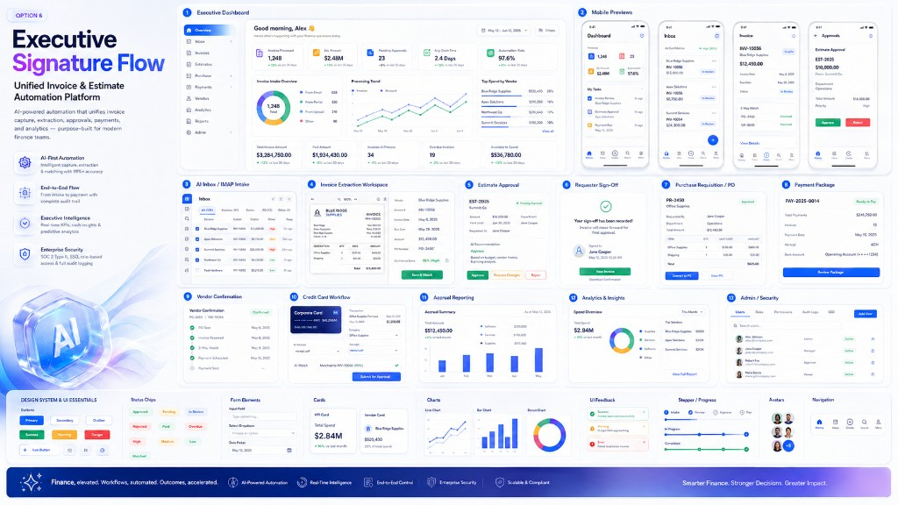

# Executive Signature Flow
## Mandatory UI/UX Implementation Standard for the Unified Invoice & Estimate Automation Platform

**Document type:** Cursor implementation specification  
**Status:** Mandatory visual and interaction baseline  
**Applies to:** All browser, tablet and mobile-responsive screens  
**Companion to:** `Unified_Invoice_Automation_Web_IMAP_Requirements_v2.docx` and `Cursor_Master_Prompt_Unified_Invoice_Automation_Web_IMAP_v2.md`  
**Reference board:** `docs/design/references/executive-signature-flow.png`  
**Design direction:** Combined Executive Glass Flow + Signature AI Finance Suite  
**Working theme name:** Executive Signature Flow

---

## 1. Purpose

This document converts the approved visual concept into enforceable implementation requirements. It is not a loose mood board and must not be interpreted as optional inspiration.

The completed application must preserve the reference board’s defining qualities:

- premium enterprise-finance credibility;
- bright, calm and uncluttered surfaces;
- blue-to-violet signature gradients;
- soft glass treatment used selectively rather than everywhere;
- strong executive dashboarding;
- clear end-to-end workflow storytelling;
- AI assistance that is visible, controlled and trustworthy;
- high-density financial information that remains easy to scan;
- consistent desktop, tablet and mobile experiences;
- refined transitions and microinteractions;
- comprehensive status, audit and exception visibility;
- a polished design system rather than isolated attractive screens.

The interface must feel purpose-built for invoice, estimate, approval and payment operations. It must not look like a generic admin template, a consumer banking app, an accounting spreadsheet, or a collection of disconnected component-library examples.

---

## 2. Authority and precedence

Use the following precedence when requirements appear to conflict:

1. Security, authorization, audit and financial-control requirements.
2. Authoritative business and functional requirements.
3. Accessibility and usability requirements in this document.
4. The reference board’s visual and interaction direction.
5. Individual third-party component defaults.

Third-party components must be restyled to this system. Do not allow MagicUI, 21st.dev, shadcn/ui, Radix, charting libraries or generated components to introduce their own conflicting visual language.

The application must remain fully functional when decorative effects, AI features, animation or background media are disabled.

---

## 3. Non-negotiable design outcome

The result must communicate all of the following within the first few seconds of use:

1. **Control:** users can see what is happening from intake through payment and accrual.
2. **Clarity:** every record has a status, owner, next action, urgency and evidence trail.
3. **Intelligence:** AI reduces manual work but does not obscure decisions.
4. **Trust:** approvals, changes, exceptions and submissions are visibly auditable.
5. **Momentum:** workflows feel fast and guided, not bureaucratic or confusing.
6. **Quality:** the product feels comparable to the strongest modern enterprise SaaS platforms.

### 3.1 Anti-drift rules

Do not:

- replace the light premium theme with a conventional dark admin theme;
- use gradients on every card or text element;
- use excessive glow, blur, animation, parallax or floating particles in working screens;
- use oversized marketing illustrations inside high-frequency operational pages;
- hide critical financial information behind hover-only interactions;
- use colour as the only status indicator;
- use tiny text to fit more information;
- render dense tables without hierarchy, sticky headers and responsive alternatives;
- introduce a second design system or inconsistent button language;
- place an always-open chatbot over essential workflow controls;
- use fake data, non-functional buttons or static charts in production;
- sacrifice performance or accessibility for visual effects;
- generate a generic dashboard that only resembles the reference board at a distance.

---

## 4. Experience principles

### 4.1 Next action first

The most important action for the signed-in user must be visible without searching. Dashboards and work queues must prioritize records requiring attention over passive reporting.

### 4.2 Explain before blocking

Whenever the system blocks submission, approval, payment preparation or closure, clearly state:

- what is missing or invalid;
- why it matters;
- who can fix it;
- the exact next action;
- whether AI made or supported the finding.

### 4.3 Evidence beside the decision

Users must be able to review source documents, extracted values, matching evidence, approval history and exceptions without repeatedly navigating away.

### 4.4 Progressive disclosure

Show the most decision-relevant information first. Secondary metadata, raw headers, technical diagnostics and detailed audit records belong in drawers, tabs or expandable sections.

### 4.5 AI with visible boundaries

AI suggestions must be clearly labelled, confidence-scored and reviewable. AI must never visually masquerade as an approved fact or completed control.

### 4.6 Consistent workflow grammar

The same interaction patterns must be used for:

- Approve;
- Reject;
- Request changes;
- Request information;
- Assign;
- Escalate;
- Save draft;
- Submit;
- Mark exception;
- Retry/reprocess.

### 4.7 Delight without distraction

Use subtle success feedback, smooth transitions and premium visual polish. Operational users must never wait for animation to complete before working.

---

## 5. Brand and visual identity

### 5.1 Core visual personality

The visual system is:

- executive;
- intelligent;
- precise;
- calm;
- optimistic;
- secure;
- premium;
- modern without appearing experimental.

### 5.2 Theme composition

Use approximately:

- **75%** warm white and cool neutral surfaces;
- **15%** navy, blue and slate structure;
- **7%** blue-to-violet signature accents;
- **3%** semantic success, warning, danger and information colours.

### 5.3 Logo and product mark

Until a final identity is approved, create a simple product mark based on:

- a four-point intelligence sparkle;
- a controlled-flow or connected-document motif;
- rounded geometry;
- blue-to-violet gradient;
- a single-colour fallback for audit documents and accessibility.

Do not copy the glass AI cube from the board as the primary logo. It may be used as a launch or empty-state visual asset only.

---

## 6. Design tokens

All tokens must be implemented as semantic CSS custom properties and mapped into the Tailwind configuration. Components must consume semantic tokens rather than raw colour values.

### 6.1 Typography

Preferred font stack:

```css
--font-sans: "Inter", "Geist", "Segoe UI", system-ui, -apple-system, sans-serif;
--font-mono: "JetBrains Mono", "SFMono-Regular", Consolas, monospace;
```

Use one sans-serif family across the product. Do not mix decorative display fonts into the operational application.

| Token | Desktop size | Line height | Weight | Use |
|---|---:|---:|---:|---|
| `display-xl` | 48px | 1.05 | 720 | marketing/launch only |
| `display-lg` | 40px | 1.10 | 700 | major product title only |
| `heading-1` | 32px | 1.20 | 680 | page title |
| `heading-2` | 24px | 1.25 | 650 | major section |
| `heading-3` | 20px | 1.30 | 620 | card/section title |
| `body-lg` | 16px | 1.55 | 450 | introductory text |
| `body` | 14px | 1.50 | 430 | standard UI text |
| `body-sm` | 13px | 1.45 | 430 | dense tables and metadata |
| `caption` | 12px | 1.40 | 500 | labels and timestamps |
| `overline` | 11px | 1.30 | 650 | uppercase category label |
| `money-lg` | 26px | 1.10 | 700 | KPI amount |
| `money` | 15px | 1.35 | 620 | financial values |

Rules:

- Financial amounts must use tabular numerals.
- Body text must not be smaller than 13px on desktop or mobile.
- Table body text should default to 13px and may use 14px on lower-density views.
- Avoid all-uppercase labels longer than three words.
- Use sentence case for buttons, headings and navigation.

### 6.2 Core colours

```css
:root {
  --background: #F7F9FC;
  --background-warm: #FBFCFE;
  --surface: #FFFFFF;
  --surface-subtle: #F4F7FB;
  --surface-raised: rgba(255,255,255,0.88);
  --surface-glass: rgba(255,255,255,0.72);

  --text-strong: #0B1739;
  --text: #24324D;
  --text-muted: #66738C;
  --text-subtle: #8C98AD;
  --text-inverse: #FFFFFF;

  --border: #E2E8F2;
  --border-strong: #CBD5E3;
  --divider: #E9EEF5;

  --primary-50: #EFF6FF;
  --primary-100: #DBEAFE;
  --primary-200: #BFDBFE;
  --primary-300: #93C5FD;
  --primary-400: #60A5FA;
  --primary-500: #3B82F6;
  --primary-600: #2563EB;
  --primary-700: #1D4ED8;
  --primary-800: #1E40AF;
  --primary-900: #172E78;

  --indigo-500: #6366F1;
  --indigo-600: #4F46E5;
  --violet-500: #8B5CF6;
  --violet-600: #7C3AED;
  --cyan-500: #06B6D4;

  --success-50: #ECFDF5;
  --success-600: #059669;
  --success-700: #047857;
  --warning-50: #FFF7ED;
  --warning-600: #EA580C;
  --warning-700: #C2410C;
  --danger-50: #FEF2F2;
  --danger-600: #DC2626;
  --danger-700: #B91C1C;
  --info-50: #EFF6FF;
  --info-600: #2563EB;
}
```

### 6.3 Signature gradients

Use gradients only for:

- product title accent;
- primary launch/marketing visual;
- small AI indicators;
- selected premium callouts;
- footer or global accent strip;
- limited active navigation treatment.

```css
--gradient-signature: linear-gradient(110deg, #2563EB 0%, #4F46E5 48%, #8B5CF6 100%);
--gradient-signature-soft: linear-gradient(135deg, rgba(37,99,235,.12), rgba(139,92,246,.10));
--gradient-ai: linear-gradient(135deg, #2563EB 0%, #7C3AED 55%, #38BDF8 100%);
--gradient-footer: linear-gradient(90deg, #102A72 0%, #274AC7 52%, #8B5CF6 100%);
```

Never place important body text over a gradient unless contrast is tested and remains WCAG AA.

### 6.4 Radius

```css
--radius-xs: 6px;
--radius-sm: 8px;
--radius-md: 12px;
--radius-lg: 16px;
--radius-xl: 22px;
--radius-pill: 999px;
```

Usage:

- inputs and compact controls: 8–10px;
- buttons: 9–12px;
- ordinary cards: 14–16px;
- hero, large workspace or premium summary cards: 18–22px;
- status chips: pill radius.

Do not make every control pill-shaped.

### 6.5 Shadows and elevation

```css
--shadow-xs: 0 1px 2px rgba(15,23,42,.05);
--shadow-sm: 0 4px 14px rgba(30,64,175,.06);
--shadow-md: 0 10px 30px rgba(30,64,175,.09);
--shadow-lg: 0 22px 60px rgba(30,41,59,.14);
--shadow-focus: 0 0 0 3px rgba(37,99,235,.22);
```

Rules:

- use borders plus soft shadow, not shadow alone;
- reserve `shadow-lg` for overlays, launch visuals and critical drawers;
- hover elevation may increase by one level only;
- cards must not appear to float excessively.

### 6.6 Blur and glass

Glass is an accent, not the default card style.

```css
--glass-blur: 18px;
--glass-border: rgba(255,255,255,.62);
```

Use glass on:

- top-level AI assistant summary;
- launch or empty-state imagery;
- compact floating command palette;
- selected executive callout cards;
- mobile overlay sheets.

Do not use glass behind long tables, data-entry forms or document text.

### 6.7 Spacing

Use an 8px base system with 4px half-steps.

```text
4, 8, 12, 16, 20, 24, 32, 40, 48, 64, 80
```

Standard patterns:

- app page padding: 24px desktop, 20px tablet, 16px mobile;
- card padding: 20–24px desktop, 16px compact/mobile;
- form control gaps: 16px;
- section gaps: 24–32px;
- major page regions: 32–48px;

### 6.8 Density modes

Support:

- **Comfortable** as the default;
- **Compact** for invoice registers, work queues and audit tables.

Compact mode may reduce row height and horizontal padding but must not reduce text below the minimum sizes or touch targets below accessibility standards.

---

## 7. Application shell

### 7.1 Desktop shell

- Persistent left navigation: 232px expanded, 72px collapsed.
- Main background: `--background`.
- Top utility bar: 64px.
- Content uses full available width; do not impose a narrow marketing-style max width on operational screens.
- Typical content max width for dashboard cards: 1760px with fluid margins.
- Document-review workspaces may use the entire viewport width.

### 7.2 Sidebar

Order:

1. Overview
2. Inbox
3. Invoices
4. Estimates
5. Approvals
6. Purchase
7. Payments
8. Vendors
9. Credit cards
10. Accruals
11. Analytics
12. Reports
13. Admin, permission controlled

Sidebar behaviour:

- selected item uses a soft blue surface, primary icon and subtle left or inner glow;
- use icons plus visible labels in expanded mode;
- tooltips are mandatory in collapsed mode;
- nested sections open with a 160–200ms height/fade transition;
- navigation state must persist per user;
- do not rely on icon meaning alone.

### 7.3 Top utility bar

Include:

- page breadcrumb when depth exceeds one level;
- global command/search control;
- task or exception indicator;
- notifications;
- help/guide access;
- user menu;
- environment label outside production;
- optional density selector.

### 7.4 Page header

Every primary page must contain:

- clear title;
- concise purpose or status summary where helpful;
- primary action;
- relevant filters or date period;
- optional AI summary card only when it adds decision value.

---

## 8. Motion and transition system

Motion must reinforce hierarchy, state and continuity. It must never delay a financial action.

### 8.1 Motion tokens

```css
--duration-instant: 90ms;
--duration-fast: 140ms;
--duration-standard: 220ms;
--duration-emphasis: 320ms;
--duration-celebration: 520ms;

--ease-standard: cubic-bezier(.2,.8,.2,1);
--ease-enter: cubic-bezier(.16,1,.3,1);
--ease-exit: cubic-bezier(.4,0,1,1);
```

### 8.2 Required transitions

| Interaction | Behaviour |
|---|---|
| Page change | 140–220ms opacity + 6px vertical settle; no dramatic slide |
| Drawer | 220–280ms horizontal slide with backdrop fade |
| Modal | 180–240ms fade + scale from 0.98 to 1 |
| Card hover | 140ms border emphasis + 1–2px elevation |
| Button press | 90ms scale to 0.985 then return |
| Status change | 180ms colour fade; preserve readable text |
| Table row open | 180–220ms detail expansion |
| AI processing | restrained shimmer/progress; never indefinite without text |
| Success | check draw/bounce under 520ms; no mandatory confetti |
| Chart load | staggered 200–500ms reveal; bypass on repeat navigation |
| Stepper | progress line animates toward confirmed state |

### 8.3 Reduced motion

Respect `prefers-reduced-motion`. In reduced-motion mode:

- disable parallax, floating and decorative looping motion;
- replace slide/scale transitions with short opacity transitions;
- show all chart values immediately;
- disable confetti and animated background ribbons;
- retain progress/state changes in a non-animated form.

### 8.4 MagicUI usage

MagicUI may be used for:

- animated gradient border on a single AI insight card;
- subtle number ticker on executive KPIs;
- restrained shimmer during extraction;
- marquee only for non-critical launch/feature presentation, never workflow content;
- animated beams only in onboarding or architecture illustrations;
- spotlight or aurora background only on the login/launch screen or empty states;
- blur/fade text reveal only for launch messaging.

Do not use multiple animated MagicUI effects simultaneously on an operational page.

### 8.5 21st.dev usage

Use 21st.dev to source or accelerate:

- application shell patterns;
- data tables;
- command palettes;
- approval timelines;
- slide-over panels;
- KPI cards;
- document workspace framing;
- filter toolbars;
- notification centres;
- empty states;
- responsive navigation.

Every imported component must be audited for:

- design-token alignment;
- keyboard support;
- screen-reader labelling;
- mobile behaviour;
- performance;
- loading, error, empty and disabled states;
- security-sensitive data leakage.

### 8.6 Higgsfield usage

Use Higgsfield only for supporting visual assets, not core UI controls.

Recommended assets:

1. a 3–5 second product intro with a glass intelligence mark and flowing blue/violet ribbons;
2. a static or very low-motion AI empty-state asset;
3. a subtle workflow journey animation for onboarding;
4. an optional launch video for stakeholder presentations.

Requirements:

- provide WebM/MP4 and static poster fallback;
- lazy-load nonessential media;
- never autoplay audio;
- honour reduced motion;
- cap looping assets at a modest file size;
- do not embed generated text inside videos that must remain legible or translatable;
- do not block login, navigation or core workflow rendering.

---

## 9. Required page designs

## 9.1 Login and secure entry

### Outcome
Provide a premium, trusted entry point without feeling like a public marketing page.

### Layout

- 40/60 or 45/55 split on wide screens;
- left: product value statement and subtle signature visual;
- right: secure sign-in card;
- mobile: sign-in card first, decorative visual reduced or removed.

### Required elements

- product mark and name;
- “Sign in securely” heading;
- SSO/OIDC button;
- privacy and acceptable-use notice;
- support link;
- environment badge when not production;
- no mailbox credentials exposed to users;
- no local-password interface unless explicitly enabled and security-approved.

### Motion

- one-time 320ms hero reveal;
- static fallback immediately available;
- no looping animation behind form fields.

---

## 9.2 Executive dashboard

### Outcome
Provide an immediate view of throughput, exposure, urgency and bottlenecks.

### Above-the-fold hierarchy

1. Greeting and reporting period.
2. Five primary KPI cards.
3. Work requiring attention.
4. Intake/processing trends.
5. spend, vendors and status distribution.

### Primary KPIs

Use role-aware cards such as:

- invoices processed;
- invoice value;
- pending approvals;
- average cycle time;
- automation rate;
- overdue value;
- payments ready;
- accrual exposure.

Each KPI card must include:

- value;
- label;
- comparison period;
- directional indicator;
- tooltip defining the metric;
- click-through filter where authorized;
- loading skeleton;
- no-data state.

### Charts

- intake source/status donut;
- processing trend line;
- top vendors by spend horizontal bars;
- approval bottleneck list;
- projected cash outflow where data supports it.

### AI assistance

A small “Executive intelligence” panel may summarize:

- material exceptions;
- records likely to miss SLA;
- unusual invoice concentration;
- recommended attention order.

It must state its data period and confidence/limitations.

---

## 9.3 Unified work queue

### Outcome
Give each user one place to understand and complete assigned work.

### Required columns

- record type;
- record/reference number;
- vendor;
- description/project;
- amount and currency;
- status;
- owner;
- due date;
- urgency;
- blockers;
- AI confidence where relevant;
- last activity.

### Interaction

- sticky table header;
- saved views;
- quick filters;
- column control;
- compact/comfortable density;
- keyboard row navigation;
- safe bulk actions based on permission and record state;
- click opens side preview or full workspace;
- selected-row state persists when returning.

Do not allow bulk approval of high-risk or policy-blocked items without explicit review controls.

---

## 9.4 AI inbox / IMAP intake

### Outcome
Make mailbox ingestion visible and manageable without recreating a full email client.

### Layout

- left: source/folder/category navigation;
- centre: ingested-message list;
- right or slide-over: message/document summary and processing status.

### Required information

- detected original sender;
- forwarding sender when different;
- subject;
- received time;
- document type;
- attachment count/types;
- scan result;
- extraction status;
- AI confidence;
- duplicate indicator;
- linked workflow record;
- processing attempt/error status.

### Statuses

- New;
- Scanning;
- Quarantined;
- Extracting;
- Needs review;
- Processed;
- Duplicate;
- Exception.

### Interaction

- users can preview sanitized message content;
- raw technical headers are permission-restricted and placed in a diagnostic drawer;
- authorized users can retry or reprocess with a reason;
- attachment downloads require authorization and audit;
- processing errors explain recovery action;
- never display remote images by default.

### AI visual language

Use a small sparkle icon plus confidence label. Do not use a robot avatar on every row.

---

## 9.5 Invoice extraction workspace

### Outcome
Enable fast, accurate human verification against source evidence.

### Desktop layout

Use a resizable split workspace:

- **Left 56–62%:** document viewer;
- **Right 38–44%:** extracted data, validation, matches, supporting documents and timeline.

Minimum useful width: 1180px. Below that, switch to tabbed document/data views.

### Document viewer

Include:

- thumbnail/page navigation;
- zoom;
- rotate;
- fit width/page;
- full screen;
- search when text is available;
- safe download when permitted;
- evidence bounding-box highlights;
- sanitized preview for supported file types;
- unsupported/encrypted/corrupt-file state.

### Extracted-data panel

Sections:

1. Header details.
2. Amounts and currency.
3. Vendor and requester.
4. PO/estimate match.
5. Line items.
6. Supporting documents.
7. Validation and exceptions.
8. Audit/timeline.

For each AI-extracted field show:

- value;
- confidence;
- evidence jump/highlight;
- edited state;
- accepted state;
- validation issue;
- source/model version in detailed metadata.

### Primary actions

- Save draft;
- Save and match;
- Request information;
- Mark exception;
- Send for sign-off/approval when valid.

### Sticky action bar

The primary action area must remain visible without covering document content.

---

## 9.6 Estimate review and approval

### Outcome
Allow approvers to understand the request, commercial terms, budget impact and supporting evidence quickly.

### Required content

- estimate number;
- supplier;
- requester and department;
- project/purpose;
- date and validity period;
- line items;
- subtotal, tax and total;
- supporting files;
- budget/threshold context where available;
- prior related estimates/invoices;
- AI summary and anomaly findings;
- approval route and history.

### Actions

- Approve;
- Reject with mandatory reason;
- Request changes;
- Request information;
- Delegate when permitted.

### Confirmation

Approval confirmation must show exactly what is being approved and the resulting next step.

---

## 9.7 Requester sign-off

### Outcome
Obtain explicit confirmation that the invoice is valid and goods/services were received.

### Design

Use a focused, low-distraction page or secure deep-link experience.

### Required elements

- invoice summary;
- vendor;
- amount;
- PO/project reference;
- supporting evidence;
- receipt-of-goods/services confirmation;
- optional/required comments based on response;
- decline/dispute path;
- reminder history;
- signed-by and timestamp evidence after completion.

### Success state

Use a restrained check animation and clear statement of the next step. Confetti is allowed only as a subtle, short, non-blocking effect and must be disabled for reduced motion.

---

## 9.8 Approval queue and approval detail

### Outcome
Reduce approval delay while preserving financial control.

### Queue

Show:

- priority;
- aging/SLA;
- amount;
- vendor;
- requester;
- approval level;
- blockers;
- exception flags;
- delegation status.

### Approval detail

Use a timeline/stepper for Unit Head, Manager, HOD and COO stages. Support sequential and parallel routes.

### Visual rules

- completed steps: success colour and timestamp;
- current step: primary blue with subtle pulse only during live processing;
- future steps: neutral;
- rejected/returned: danger with reason;
- delegated: explicit actor chain.

Never represent “submitted” as “approved.”

---

## 9.9 Purchase requisition and purchase order

### Outcome
Make threshold-triggered procurement controls clear and traceable.

### Required content

- threshold reason;
- originating estimate/invoice;
- requester;
- department;
- supplier/vendor reference;
- requisition line items;
- amount and currency;
- required-by date;
- approval route;
- PO reference and status;
- invoice matching summary.

### Layout

Use a form-plus-summary pattern with a sticky total panel. On approval, show a conversion flow rather than replacing the requisition silently.

---

## 9.10 Payment package

### Outcome
Aggregate approved invoices into a complete, reviewable submission package.

### Required summary cards

- invoice count;
- vendor count;
- total amount by currency;
- payment method;
- intended payment date;
- exceptions/blockers;
- package status.

### Invoice table

Include:

- selection;
- invoice number;
- vendor;
- amount;
- due date;
- urgency;
- approval state;
- supporting-document completeness;
- duplicate/exception status.

### Actions

- Review package;
- Generate manifest;
- Download authorized package;
- Submit/reference submission;
- Return item to exception.

Totals must update deterministically and visibly when records are added or removed.

---

## 9.11 Vendor payment confirmation

### Outcome
Track payment status and vendor acknowledgement without treating unverified email content as authoritative.

### Required views

- payment/package timeline;
- vendor outreach status;
- signed-link response status;
- correlated reply status;
- Paid/Outstanding suggestion;
- reviewer decision;
- follow-up schedule;
- exception/escalation state.

### Visual treatment

Use a timeline with clear distinctions among:

- internal submission;
- bank/payment evidence;
- outbound vendor request;
- vendor response;
- reviewed confirmation.

Do not display a green “Paid” success state before the required review/evidence condition is satisfied.

---

## 9.12 Credit card workflow

### Outcome
Make statement transactions, receipts, coding and reconciliation easy to complete.

### Layout

- statement summary header;
- transaction table;
- right-side transaction review drawer;
- receipt/document preview;
- AI match/coding suggestion;
- period close controls.

### Required transaction fields

- date;
- merchant;
- amount and currency;
- cardholder;
- category;
- GL code;
- cost centre;
- receipt status;
- matching confidence;
- exception reason;
- approval state.

### AI

AI suggestions must present evidence and allow quick accept/edit/reject. Never automatically close a statement period based only on model output.

---

## 9.13 Accrual reporting

### Outcome
Identify, review and finalize month-end accrual candidates with full traceability.

### Required dashboard

- total proposed accrual;
- new accruals;
- reversals/adjustments;
- finalized value;
- open candidate count;
- aging;
- top departments/accounts/vendors.

### Required workflow

1. Generate candidates.
2. Review evidence.
3. Edit with reason.
4. Approve/finalize.
5. Lock period.
6. Export.

### Visual rules

- proposed, adjusted and finalized values must be visually distinct;
- negative adjustments require sign and semantic styling;
- locked periods must be obvious and read-only;
- export status and version must be visible.

---

## 9.14 Analytics and reporting

### Outcome
Provide decision-grade operational and financial insights without creating misleading precision.

### Core reports

- intake volume;
- cycle time;
- approval aging;
- overdue invoices;
- payment urgency;
- spend by vendor/department/category;
- AI extraction confidence and correction rate;
- exception rate;
- reminder effectiveness;
- vendor confirmation aging;
- accrual movement.

### Charts

- use line charts for trends;
- bars for comparison;
- donut only for a small number of categories;
- tables for exact values;
- avoid 3D charts;
- never use decorative chart gradients that obscure values;
- include accessible text summaries and downloadable data where permitted.

---

## 9.15 Administration and security

### Outcome
Allow controlled configuration without exposing secrets or weakening segregation of duties.

### Sections

- users;
- roles and permissions;
- approval matrix;
- thresholds;
- vendor reference data;
- GL/cost-centre data;
- templates;
- schedules/reminders;
- IMAP status and configuration references;
- SMTP status and configuration references;
- AI configuration and kill switch;
- retention;
- integrations;
- audit logs;
- operational health.

### Design rules

- settings pages use clear sections and descriptive text;
- dangerous actions use separate danger zones;
- secrets are masked and never returned after storage;
- save actions identify changed fields;
- changes require reason where policy dictates;
- audit preview is available before high-impact changes;
- do not place unrelated settings on one giant screen.

---

## 9.16 Mobile-responsive approval experience

Mobile is required for review and approval, not for every administrative function.

### Mobile priority pages

- personal dashboard;
- work queue;
- invoice/estimate summary;
- document preview;
- approval decision;
- requester sign-off;
- notifications;
- search.

### Mobile patterns

- bottom navigation for 4–5 highest-frequency areas;
- full-screen sheets for actions;
- sticky approval bar;
- cards replace wide tables;
- amount, vendor, status and exceptions remain above the fold;
- documents use a dedicated viewer mode;
- no horizontal scrolling for ordinary workflows;
- minimum 44px touch targets.

Admin, complex report-building and dense reconciliations may show a clear desktop-required message when a safe mobile layout cannot support the task.

---

## 10. Component standards

## 10.1 Buttons

### Variants

- Primary: signature blue, white text.
- Secondary: white or subtle surface, strong border.
- Tertiary: text/icon with no filled background.
- Success: only for explicit positive completion/approval.
- Danger: destructive or rejection actions.
- AI action: primary or secondary plus sparkle icon; do not create a separate rainbow button language.

### Rules

- one primary action per action group;
- labels begin with verbs;
- loading state retains width;
- destructive actions require appropriate confirmation;
- icon-only buttons require accessible labels and tooltips;
- disabled buttons explain why through adjacent text or tooltip.

## 10.2 Status chips

Every status chip includes text and may include an icon.

Suggested mapping:

- New: blue;
- Scanning/Extracting: indigo;
- In review: blue-violet;
- Pending sign-off/approval: amber;
- Approved/Confirmed/Paid: green;
- Ready for submission: cyan/blue;
- Outstanding/At risk: orange;
- Exception/Rejected/Overdue: red;
- Draft/Cancelled: slate;
- Accrual needed: violet.

Do not create visually indistinguishable chips for materially different states.

## 10.3 Cards

Card anatomy:

- optional icon/status;
- title;
- primary value/content;
- supporting label;
- trend/action;
- optional footer.

Cards must not contain multiple competing primary actions.

## 10.4 Tables

Required:

- sticky headers for long lists;
- column sort where meaningful;
- filter state visible;
- row hover and keyboard focus;
- empty/loading/error states;
- pagination or virtualization;
- permission-aware column visibility;
- responsive card mode;
- totals where financially relevant;
- export audit notice.

Use right alignment for numeric values and amounts.

## 10.5 Forms

- labels remain visible; do not rely on placeholders;
- helper text explains policy or format;
- validation appears close to the field;
- required fields are indicated consistently;
- unsaved-change warning is mandatory;
- sections are logically grouped;
- use progressive disclosure for uncommon fields;
- auto-saved drafts display last-save state.

## 10.6 Drawers and modals

Use a drawer for contextual review that benefits from retaining the background page. Use a modal for a focused decision or confirmation.

Do not stack more than one modal. Avoid nested drawers.

## 10.7 Timeline and steppers

- timeline: audit history and chronological events;
- stepper: expected workflow sequence;
- show actor, timestamp and result;
- distinguish system, AI, user and external-vendor events with label/icon, not colour alone.

## 10.8 Toasts and notifications

Toasts are for brief confirmation, not critical decisions.

- success: 4–6 seconds;
- warning/error: persist long enough to read and provide action;
- important failures also appear inline or in notification centre;
- never rely on toast alone for a failed financial submission.

## 10.9 AI assistant

The assistant must be contextual and collapsible.

Preferred presentation:

- compact insight card;
- right-side drawer;
- field-level suggestion;
- command-palette action.

It may:

- summarize the current document;
- explain exceptions;
- propose matches or coding;
- draft communications;
- suggest next actions.

It must not:

- obscure source evidence;
- appear to authorize an action;
- be the only way to perform a core task;
- expose unrelated records;
- retain a conversation that violates data-minimization rules.

Required footer: “AI suggestions can be incorrect. Verify before acting.”

---

## 11. Content and language

### 11.1 Tone

Use direct, calm and professional language.

Preferred:

- “PO number is required because this invoice exceeds the configured threshold.”
- “Request information”
- “Ready for submission”
- “2 approvals remain”

Avoid:

- “Oops!” for financial errors;
- vague messages such as “Something went wrong” without guidance;
- overly technical infrastructure language in user-facing screens;
- anthropomorphic claims that AI “knows” or “decided.”

### 11.2 Amounts and dates

- display currency explicitly where ambiguity exists;
- use locale-aware formatting;
- preserve source currency;
- align amounts consistently;
- show timezone context where timestamps matter;
- do not abbreviate large financial values without a tooltip or exact-value view.

### 11.3 Empty states

Every empty state must explain:

- what the page contains;
- why it may be empty;
- the next useful action;
- whether filters are hiding results.

---

## 12. Accessibility requirements

Meet WCAG 2.2 AA across all mandatory screens.

Required:

- complete keyboard operation;
- visible focus with `--shadow-focus` or equivalent;
- logical heading hierarchy;
- form labels and descriptions;
- status announced to assistive technology;
- chart text summaries;
- accessible table captions/headers;
- 4.5:1 body-text contrast and 3:1 large-text/UI-component contrast;
- no critical information conveyed by colour alone;
- 200% browser zoom without loss of content or function;
- reduced-motion support;
- minimum 44x44px primary mobile touch targets;
- error summaries for multi-field forms;
- skip links for navigation and repetitive regions;
- screen-reader-readable document-viewer controls.

Run automated checks and manual keyboard/screen-reader review. Automated accessibility scans alone are insufficient.

---

## 13. Responsive breakpoints

Use content-driven layouts with these baseline breakpoints:

```text
sm: 640px
md: 768px
lg: 1024px
xl: 1280px
2xl: 1536px
```

### Behaviour

- Under 1280px: reduce dashboard columns and collapse secondary side panels.
- Under 1024px: sidebar defaults collapsed; split workspaces become resizable or tabbed.
- Under 768px: use mobile navigation, cards instead of wide tables, full-screen action sheets.
- Under 640px: single-column layout with sticky primary action.

Do not merely shrink desktop UI.

---

## 14. Loading, error and system states

Every page must implement:

- initial loading skeleton;
- partial loading;
- empty state;
- permission denied;
- record not found;
- validation failure;
- recoverable server error;
- offline/network interruption;
- maintenance mode;
- stale-data indication;
- concurrent-edit conflict;
- AI unavailable/manual fallback;
- IMAP/SMTP degraded status where relevant.

Skeletons should resemble final geometry and must not shimmer indefinitely.

---

## 15. Frontend implementation requirements

### 15.1 Recommended stack

Use the existing React + TypeScript direction with:

- Tailwind CSS using semantic design tokens;
- shadcn/ui and Radix primitives for accessible foundations;
- TanStack Query;
- TanStack Table;
- React Hook Form;
- Zod;
- PDF.js;
- Framer Motion or Motion for React;
- Recharts, Visx or another accessible charting library;
- Lucide icons;
- Storybook or equivalent component catalogue;
- Playwright for end-to-end and visual-regression testing.

Do not switch architecture solely to accommodate a component library.

### 15.2 Theme structure

Create:

```text
/src/styles/tokens.css
/src/styles/theme.css
/src/styles/motion.css
/src/components/ui/
/src/components/finance/
/src/components/workflow/
/src/components/ai/
/src/components/document/
/src/components/charts/
/src/layouts/
/src/pages/ or /src/features/
/stories/
/tests/visual/
```

### 15.3 Component ownership

- `ui/`: primitive reusable controls;
- `finance/`: money, totals, vendor, invoice and accounting components;
- `workflow/`: status, timeline, approval and action components;
- `ai/`: confidence, evidence and suggestion components;
- `document/`: safe viewer and source-evidence components;
- `charts/`: approved chart wrappers with accessible summaries.

Business pages must not directly style raw third-party components repeatedly. Wrap and standardize them.

### 15.4 Required reusable components

At minimum:

- `AppShell`
- `PageHeader`
- `KpiCard`
- `MetricTrend`
- `StatusChip`
- `UrgencyIndicator`
- `MoneyValue`
- `VendorIdentity`
- `WorkQueueTable`
- `FilterBar`
- `SavedViewMenu`
- `DocumentViewer`
- `EvidenceHighlight`
- `ExtractedField`
- `ConfidenceBadge`
- `ValidationSummary`
- `ExceptionCard`
- `WorkflowStepper`
- `AuditTimeline`
- `ApprovalActions`
- `StickyActionBar`
- `AiInsightCard`
- `AiAssistantDrawer`
- `NotificationCentre`
- `CommandPalette`
- `EmptyState`
- `ErrorState`
- `PermissionState`
- `ResponsiveDataCard`

---

## 16. Design-system documentation

Build a living component catalogue containing:

- tokens;
- typography;
- colours;
- buttons;
- fields;
- selectors;
- date controls;
- chips;
- cards;
- tables;
- charts;
- navigation;
- overlays;
- AI states;
- document states;
- timelines;
- notifications;
- loading/error/empty states;
- responsive examples;
- accessibility notes;
- approved motion examples.

Each component entry must show:

- purpose;
- anatomy;
- variants;
- states;
- allowed usage;
- prohibited usage;
- keyboard behaviour;
- responsive behaviour;
- accessibility requirements.

---

## 17. Visual QA and screenshot parity

The implementation is not visually complete until it passes screenshot-based review against the reference direction.

### 17.1 Required capture sizes

Capture every core screen at:

- 1920x1080 desktop;
- 1440x900 desktop/laptop;
- 1280x800 compact desktop;
- 1024x768 tablet landscape;
- 768x1024 tablet portrait where supported;
- 390x844 mobile;
- 360x800 mobile.

### 17.2 Required screen states

For each primary page capture:

- normal populated state;
- loading;
- empty;
- validation or exception;
- permission-restricted where relevant;
- responsive mobile/tablet state;
- AI available;
- AI unavailable/manual fallback where relevant.

### 17.3 Review criteria

Score each core screen from 1–5 for:

1. visual fidelity to Executive Signature Flow;
2. hierarchy;
3. readability;
4. spacing consistency;
5. component consistency;
6. workflow clarity;
7. responsive behaviour;
8. accessibility;
9. motion quality;
10. production completeness.

No core screen may ship with a score below 4 in any category.

### 17.4 Automated visual regression

- establish approved baseline screenshots;
- use deterministic data fixtures;
- mask volatile timestamps only when necessary;
- fail CI on unapproved material differences;
- review changes at multiple viewports;
- include high-contrast and reduced-motion modes where applicable.

---

## 18. Cursor execution instructions

Cursor must treat this document as a build contract.

### 18.1 Before implementation

1. Read the authoritative business requirements.
2. Read the Web + IMAP master prompt.
3. Load the reference board.
4. Inventory existing frontend code and dependencies.
5. Create a page/state matrix.
6. Create a component and token plan.
7. Identify where MagicUI, 21st.dev and Higgsfield add value without increasing risk.
8. Document deviations before coding.

### 18.2 Implementation sequence

1. Tokens, typography, theme and icon system.
2. App shell and responsive navigation.
3. Primitive component system.
4. Finance/workflow/document/AI components.
5. Executive dashboard.
6. Work queue and IMAP inbox.
7. Invoice extraction workspace.
8. Estimate and approval journeys.
9. Sign-off, PR/PO and payment package.
10. Vendor confirmation, credit cards and accruals.
11. Analytics and administration.
12. Loading/error/empty/accessibility states.
13. Motion and microinteraction refinement.
14. Storybook/component catalogue.
15. Visual-regression and accessibility testing.
16. Screenshot board and final parity review.

### 18.3 Required implementation passes

Perform these passes after each page:

- **Pass 1 — Functional:** real data and actions work.
- **Pass 2 — Security:** permissions and sensitive data are correct.
- **Pass 3 — Layout:** spacing, alignment and density match tokens.
- **Pass 4 — Visual:** colours, radius, shadows and typography match this standard.
- **Pass 5 — Interaction:** hover, focus, loading, success and error states work.
- **Pass 6 — Responsive:** all required viewports are usable.
- **Pass 7 — Accessibility:** keyboard, screen reader, contrast and zoom checks.
- **Pass 8 — Visual regression:** screenshots reviewed and approved.

### 18.4 Do not declare completion until

- every required page exists and is connected to real application behaviour;
- no production route is a placeholder;
- no primary action is non-functional;
- no critical state is missing;
- no visual element uses hard-coded one-off styling where a token/component is required;
- visual screenshots are indexed;
- component documentation is current;
- automated and manual accessibility checks have passed;
- approved visual-regression baselines exist;
- the product clearly reflects the Executive Signature Flow direction.

---

## 19. Acceptance criteria

The design implementation is accepted only when all of the following are true:

- The application uses a consistent premium light visual system across every module.
- The executive dashboard provides decision-useful KPIs and attention items.
- The IMAP inbox visibly communicates ingestion, security scanning and processing state.
- Invoice review uses a true source-document/extracted-data split workspace.
- AI suggestions include confidence, evidence and human controls.
- Estimate, sign-off and approval interactions are consistent and auditable.
- PR/PO thresholds and routes are understandable before submission.
- Payment packages expose totals, completeness and blockers clearly.
- Vendor confirmation does not misrepresent unverified payment status.
- Credit-card and accrual workflows support dense data without sacrificing clarity.
- Mobile approval and sign-off are usable without horizontal scrolling.
- Every page supports keyboard use and visible focus.
- Reduced-motion mode remains polished and complete.
- All screens use the shared token and component system.
- Visual-regression screenshots demonstrate adherence to the approved board.
- The interface is visually impressive while remaining simple, secure and efficient.

---

## 20. Platform-name candidates

These are branding candidates only and must undergo domain, company-name and trademark clearance before adoption.

### 1. Fluxora
**Positioning:** Intelligent financial workflows in motion.  
**Why it works:** Short, premium and adaptable beyond invoices.  
**Possible tagline:** *Finance in flow. Control at every step.*

### 2. NexLedger
**Positioning:** The connected operational layer between documents, approvals and payment.  
**Why it works:** Communicates linkage and financial credibility.  
**Possible tagline:** *Every document connected. Every decision traceable.*

### 3. Finora Flow
**Positioning:** A modern AI-assisted finance operations platform.  
**Why it works:** Warm, memorable and aligned with the blue-violet visual theme.  
**Possible tagline:** *Smarter finance, beautifully orchestrated.*

### 4. Invoxa
**Positioning:** AI-powered invoice and estimate orchestration.  
**Why it works:** Directly connected to the initial use case while sounding modern and scalable.  
**Possible tagline:** *From inbox to outcome.*

### 5. LedgerLift
**Positioning:** A platform that removes friction from finance operations.  
**Why it works:** Clear benefit, easy to remember and suitable for an internal enterprise rollout.  
**Possible tagline:** *Lift the workload. Strengthen the control.*

### Recommended naming direction

**Fluxora** is the strongest premium standalone name. **NexLedger** is the strongest name when immediate financial meaning and executive credibility are the priority.

---

## 21. Reference asset placement

Place the approved board at:

```text
docs/design/references/executive-signature-flow.png
```

Then include it in the design documentation:

```md

```

The image is a visual target. Where the board uses illustrative sample values or simplified layouts, implement the actual business rules and data structures from the authoritative requirements while preserving the board’s visual hierarchy and interaction quality.

---

## 22. Final Cursor completion report

Cursor’s final response must include:

1. implemented pages and states;
2. design-token files and component catalogue location;
3. MagicUI and 21st.dev components adopted, adapted or rejected, with reasons;
4. Higgsfield assets created and their performance/accessibility fallbacks;
5. desktop, tablet and mobile screenshot index;
6. visual-regression results;
7. accessibility results;
8. deviations from this design standard;
9. unresolved design or business decisions;
10. confirmation that all critical workflows remain usable with AI and animation disabled.

